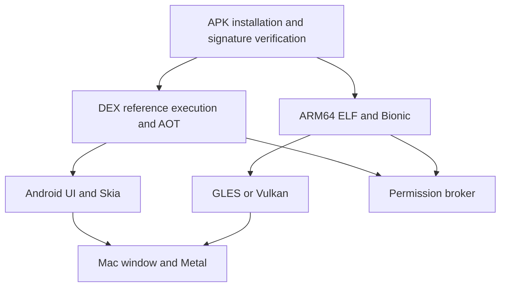

# Android App Compatibility Runtime for macOS — Design Document

For Apple Silicon | Basic Design v0.1 | November 10, 2026

Launch unmodified Android APKs from the Mac Dock and use them with their original layout, text, interactions, and game graphics intact. Without booting an Android guest OS or depending on a host JVM, we build a compatibility layer in Rust that connects app code to the Android APIs.

### Design Premises

| Category | Details |
| --- | --- |
| Confirmed requirements | Targets macOS on Apple Silicon. The Android OS is not virtualized, and the product does not require a JVM at runtime. Android rendering is preserved inside the app, while the Mac handles windowing and OS integration. |
| Initial proposal | The first test machine is a MacBook Pro M5, and the rendering baseline is AOSP Android 15 (API 35). The APK itself is never rewritten; derived code and indexes are stored in a separate cache. |
| Execution strategy | A Rust DEX interpreter is used to verify compatibility, and the portion of code compiled to ARM64 via AOT is increased incrementally. Android ARM64 native libraries are handled as an independent workstream with a dedicated loader. |
| First success criterion | With the same APK, pinned by signature and hash, Japanese line breaking, button hit testing, and redraw after a press match the reference Android. Whether the runtime can be distributed safely is judged at a separate gate. |

### How to Read This Document

| What you want to know | Relevant chapters |
| --- | --- |
| What is reused and what is built | 01 Prior Implementations and Adoption Decisions / 02 Overall Architecture |
| How an APK runs and how the screen appears | 03 APK Installation / 04 DEX / 05 Native ABI / 06 Standard UI / 07 GPU and Composition |
| Conditions for a usable Mac product | 08 Mac Interaction and Services / 09 Isolation and Distribution |
| What counts as "working" | 10 Reference APKs / 11 Differential Testing and Performance / 12 Phases and Decisions / 13 Open Issues / 14 Compatibility Ledger / Sources |

This document is the design at the start of implementation. Any performance figures or support scope marked "target" or "candidate" do not represent measurements or compatibility certification of this runtime.

## 01 Prior Implementations and Adoption Decisions

Even OSS projects that handle the same APKs differ in which layers we would want to reuse. Source reference, code incorporation, and runtime dependency are decided separately, and licenses are checked file by file before any code is incorporated.

| Prior implementation | Where to read / track record | Position in this design |
| --- | --- | --- |
| Mac.apk | "How Mac.apk Works" and BUILDING. ARM64 ELF, Bionic compatibility layer, GLES/Vulkan, per-app Mac windows. DEX is converted to JVM bytecode. [S01](https://github.com/kksimp/Mac.apk/wiki/How-Mac.apk-Works) [S02](https://github.com/kksimp/Mac.apk/blob/main/BUILDING.md) | Referenced for native ABI and GPU integration design. Core is AGPL-3.0. The JVM path falls outside our requirements. Code porting only after the license policy is decided. |
| DROIDLESS | APK/DEX parsing, managed heap, invoking listeners of the original APK. Has verification records for a calculator and a notepad. UI uses AppKit controls. [S03](https://github.com/OthmaneBlial/droidless) [S04](https://github.com/OthmaneBlial/droidless/blob/main/docs/verification.md) | Apache-2.0. Candidate for reusing the parser, DEX semantics, and verification procedures. The runtime core also contains a View model, so source boundaries must be checked and rendering dependencies cut out. |
| Avo | A Rust VMM boots Android on Hypervisor.framework. Implements per-app .app bundles, LaunchServices registration, IME, input, and the display path. [S05](https://github.com/nizwar/avo/blob/main/docs/architecture.md) | Used for Mac-side interaction design and comparative measurement. Core is Apache-2.0; engine/hvf is BSD-3-Clause. Guest booting and screen forwarding are not part of the product architecture. |
| Lunaria | Dalvik interpreter and ARM32/64 JIT via Dynarmic, JNI and GLES bridging. Known case on Mac where generated frames don't match the actual window. [S06](https://github.com/yui0/lunaria) | Research implementation, primarily MPL-2.0. Referenced for JNI and per-title defect classification. Grounds for not passing tests on offscreen images alone. |

### Components Under Consideration

AOSP framework, resources, and rendering implementation serve as the baseline for screen reproduction. Skia is a candidate for 2D rendering, ANGLE for OpenGL ES, and MoltenVK for connecting Vulkan to Metal. Rust handles API boundaries and ownership; existing C/C++ libraries are used through a narrow FFI. [S07](https://android.googlesource.com/platform/frameworks/base/+/android-15.0.0_r1/) [S08](https://chromium.googlesource.com/angle/angle/) [S09](https://github.com/KhronosGroup/MoltenVK)

Mac.apk's standalone dex2jvm can be referenced as a DEX→JVM comparison implementation. The product compiler candidate is DEX→custom IR→ARM64, with Cranelift and others evaluated for code generation. Cranelift does not provide Android APIs or DEX type rules. [S10](https://github.com/kksimp/dex2jvm) [S11](https://cranelift.dev/)

## 02 Process and Data Flow

Each app's Mac window serves as the gateway for input and display. Code controlled by the APK runs in a worker, and host privileges such as file selection and notifications are concentrated in a broker. The boundaries in the following diagram are a design proposal; actual OS isolation is verified by the tests in Chapter 09.

The diagram shows the two representative rendering paths. DEX and ARM64 ELF can call each other via JNI, and both paths send host resource requests to the broker.

| Boundary | Data contract |
| --- | --- |
| Installer → Worker | Passes the install record, read-only APK/splits, execution profile, and signature-verified derived-code identifiers. The APK input path is not treated as a capability. |
| Mac → Worker | Width, height, density, insets, orientation, display generation, monotonic time, pointer IDs, IME edit ranges. Events from stale generations are discarded and ordering is preserved. |
| Worker → Display | Surface ID and generation, size, color space, alpha, buffer identifier, completion fence. Buffers from stopped workers and incomplete frames are never referenced. |
| Worker → Broker | Operation tokens scoped to package and session, operation name, typed arguments with length limits. The broker verifies the caller and permissions on every call. |

### Process Lifetime

When opened from the Dock, the host resolves the launch record and either brings the app's existing window to the front or spawns a worker. On quit, it requests a save, stops the worker within a deadline, and discards frames and permission handles. Even if a worker crashes, the management app provides diagnostics and restart.

## 03 APK Installation and Updates

The unit of installation is managed not by "app name" but by the combination of Android package name and signer. If signature verification, input storage, or version switching fails, the currently running version is kept. [S12](https://source.android.com/docs/security/features/apksigning)

| Step | Processing and failure handling |
| --- | --- |
| 1 Read | Inspect the ZIP central directory, compressed/uncompressed sizes, entry count, duplicates, and absolute paths / path traversal. Exceeding limits is rejected before extraction. |
| 2 Identify contents | Read package, versionCode, minSdk, targetSdk, components, permissions, and features from the binary Manifest. Enumerate resources.arsc, classes*.dex, assets, and the ABIs under lib. |
| 3 Verify signature | Initial standard installation targets APK Signature Scheme v2/v3. Verify signed regions and signatures of all splits; updates to an existing version require the same signer. Key rotation is explicitly deferred until lineage verification is implemented. |
| 4 Compatibility check | Initially a single APK with a single launcher Activity. Display minSdk, required ABI, required features, and unsupported package formats on screen. Fix the class lookup order for multiple DEX files. |
| 5 Commit | Store the accepted APK by content hash and generate the resource index and AOT cache in a temporary area. On completion, atomically switch the active-version reference and register the .app launcher. |

### Extending Supported Formats

For base + config splits, package / versionCode / signer must match, and ABI, density, and language are resolved. Missing required splits are detected at install time. AAB is distinguished as a build input for distribution, and APKS as a set of APKs. XAPK/APKM, additional OBBs, and dynamic feature delivery are each handled individually at later gates. [S13](https://developer.android.com/guide/app-bundle/app-bundle-format)

### Updates and Data

Originals, derived caches, persistent app data, and diagnostics are kept in separate areas. Cache keys include the APK/split hashes, AOSP resource version, and runtime / ABI / CPU backend versions. A failed update reverts the original reference. If the database has been migrated after the app launched, automatic code downgrade is avoided and rollback is only from a compatibility backup made beforehand. The UI distinguishes reinstall, clear data, and full removal.

## 04 Executing DEX and the Android Framework

What Kotlin/Java apps put into an APK is DEX. The Rust runtime is responsible for DEX semantics, and AOT-compiled methods use the same object, exception, and calling conventions. Installing a JDK on the host is not a product runtime requirement. The development environment for building test APKs is treated separately. [S10](https://github.com/kksimp/dex2jvm) [S14](https://source.android.com/docs/core/runtime/dex-format)

| Function | Implementation order and required semantics |
| --- | --- |
| Verification and loading | Verify the DEX header, bounds, instruction branches, registers, exception ranges, and types. DEX 035–039 are candidates for the initially accepted versions, declared per fixture. Unknown instructions, versions, or duplicate definitions are logged in diagnostics and execution stops. |
| Basic execution | Implement in order: integer rounding/overflow, array bounds, null, strings, virtual/interface calls, static initialization, returns and exception propagation. Method and type identity includes the class loader. |
| Heap and threads | Objects are managed via typed handles. GC roots include frames, statics, and JNI references. Initially a single UI Looper. Dedicated tests are prepared for monitors, exception unwinding, and safepoints on other threads. |
| AOT | Implement DEX→IR→ARM64 starting with low-side-effect methods containing branches and integers. Incrementally add traps, exceptions, GC stack maps, and calling conventions. Unsupported methods fall back to reference execution or an explicit error per the execution profile. |

### Where the Android Implementation Comes From

The public SDK's android.jar is used for API type definitions. Runtime behavior is split between candidates where a pinned AOSP Java/Kotlin implementation is compiled to DEX at build time and bundled, and APIs implemented in Rust for host integration. For each target class, enumerate dependencies on native methods, hidden APIs, libcore, and system services. android.jar alone will not run a screen. [S07](https://android.googlesource.com/platform/frameworks/base/+/android-15.0.0_r1/) [S14](https://source.android.com/docs/core/runtime/dex-format)

Initially, only Activity, Context, Resources, Looper/Handler, and the call closure of selected widgets are passed through. Reflection, dynamic class loading, multiple processes, and parallel execution are made explicit at each phase. No stubs that unconditionally return success are provided; unimplemented class and method signatures and their first caller are recorded.

### Conditions for Enabling AOT

Run the same input on the Android reference device, the Rust interpreter, and AOT in that order, and confirm that values, exception types, and side effects match. Artifacts that don't meet signing and executable-memory requirements are not loaded. Reference execution for development does not involve OS virtualization. In AOT-only profiles, uncompiled reachable methods are reported explicitly and launch or execution is stopped. The distribution scope is published per profile.

## 05 ARM64 Native Code

The target is arm64-v8a ELF. Even on the same ARM64, Android and Darwin differ in variadic arguments, TLS, and system calls. Per-type ABI conversion is inserted for host calls. [S15](https://developer.android.com/ndk/guides/abis) [S16](https://developer.apple.com/documentation/xcode/writing-arm64-code-for-apple-platforms) [S17](https://android.googlesource.com/platform/bionic/+/HEAD/docs/elf-tls.md)

| Phase | Implementation and verification |
| --- | --- |
| 1 ELF | Inspect PT_LOAD sizes, alignment, overlap, and page protections. DT_NEEDED is limited to bundled and allowlisted libraries. Start with RELATIVE, GLOB_DAT, and JUMP_SLOT; RELR / packed relocations are implemented individually. Unknown types are rejected before initialization. Initializers run exactly once in dependency order. |
| 2 Bionic | Start with fixed-argument integer functions, then move to floating point, structs, and variadic arguments. errno and TLS are kept per thread; pthread, file, and time data layouts are converted. |
| 3 JNI | JNIEnv is managed per thread, and JNI_OnLoad and RegisterNatives connect DEX and ELF. Verify local/global references, return values, pending exceptions, and callbacks from native into DEX. |

### Verifying Platform-Specific ABI

The Android NDK reserves x18 for ShadowCallStack, while Apple reserves it for the platform. Mac.apk's approach requires an x18 entitlement and macOS 26.4 or later. The minimum OS version for this design is verified with distribution signing. [S02](https://github.com/kksimp/Mac.apk/blob/main/BUILDING.md) [S15](https://developer.android.com/ndk/guides/abis) [S16](https://developer.apple.com/documentation/xcode/writing-arm64-code-for-apple-platforms)

### Pass Criteria

From a self-built NDK APK, call an addition function and a native→DEX callback, and record that the executing PC lies within the ELF code region and that results match the reference Android. Retest TLS on other threads, 4/16 KiB alignment, and rejection of unknown symbols. Libraries whose C++ exceptions cross the ABI boundary and libraries that issue Linux syscalls directly are recorded as unsupported until individually implemented. Code writing and execution are separated, and we confirm that writes to executable pages fail in the signed worker. [S17](https://android.googlesource.com/platform/bionic/+/HEAD/docs/elf-tls.md) [S18](https://developer.apple.com/documentation/security/hardened-runtime)

## 06 Reproducing Standard Android UI

Use an Activity with Japanese TextView and Button. Adopt AOSP API 35's View measurement, layout, drawing, and click handling along with their dependent classes, and also run the app's onDraw and listeners in the DEX runtime. SDK stubs are used to check method types and arguments. [S07](https://android.googlesource.com/platform/frameworks/base/+/android-15.0.0_r1/)

### From Layout to Pixels

| Stage | Implementation and comparison points |
| --- | --- |
| Resources | Pass the APK and API 35 framework-res to AssetManager2. Resolve theme parents, attribute references, density, language, and night mode from resources.arsc and binary XML. Record resource IDs. [S07](https://android.googlesource.com/platform/frameworks/base/+/android-15.0.0_r1/) |
| Text | Use the target version's fonts and fallback order, and Minikin text measurement. With mixed Japanese/English text, compare line-break positions, baselines, end ellipsizing, and right-to-left display. [S23](https://android.googlesource.com/platform/frameworks/minikin/) [S35](https://source.android.com/docs/core/fonts/custom-font-fallback) |
| Drawing | The UI thread runs measure, layout, and draw. Initially draw to a Skia CPU surface at a fixed time; later, port HWUI display lists and RenderThread. GPU-specific effects are checked for conformance individually. [S24](https://android.googlesource.com/platform/frameworks/base/+/main/libs/hwui/pipeline/skia/SkiaGpuPipeline.cpp) |

### Interaction and Scope

Test press, cancel by sliding the finger off, and re-layout after text change. Pass Mac frame callbacks to Choreographer, and trace until an invalidated View is updated on the next frame. IME input is connected to InputConnection in Chapter 08. [S07](https://android.googlesource.com/platform/frameworks/base/+/android-15.0.0_r1/) [S26](https://developer.android.com/reference/android/view/inputmethod/InputConnection)

For Compose, run the AndroidX inside the APK and verify drawing, the frame clock, and recomposition. WebView requires Chromium's provider and renderer process, so it is a dedicated compatibility workstream. [S25](https://chromium.googlesource.com/chromium/src/+/refs/heads/main/android_webview/docs/architecture.md)

## 07 Game Rendering and Surface Composition

Native games are given an ANativeWindow corresponding to the Java Surface. Regular UI, game, and dialog surfaces are composited into a single Mac window. [S22](https://source.android.com/docs/core/graphics/architecture)

| Rendering path | Host responsibilities |
| --- | --- |
| OpenGL ES | Create EGL configs, contexts, and window surfaces, using ANGLE's Metal backend. After eglSwapBuffers, hand off the frame with a completion fence. [S08](https://chromium.googlesource.com/angle/angle/) |
| Vulkan | Connect vkCreateAndroidSurfaceKHR to the host display surface and send to Metal via MoltenVK. Check requested formats, extensions, queues, and swapchains, and return the names of missing features. [S09](https://github.com/KhronosGroup/MoltenVK) |

### Color and Surface Lifetime

If the screen appears dark, draw a linear gray gradient and a semi-transparent rectangle, then inspect in order the render target format, sRGB conversion, presentation surface color space, and premultiplied alpha. A linear value of 0.5 gray is about 188 in 8-bit sRGB. Use intermediate and final values to isolate missing or double-applied conversions.

On resize, update the surface generation and stop displaying old frames. Display only after writes complete, and reuse buffers only after reads complete. For minimize, restore, and orientation changes, track Activity and Surface lifetimes separately and stop drawing on destroyed surfaces. [S22](https://source.android.com/docs/core/graphics/architecture)

### On-Screen Pass Criteria

Verify launch and restore with the NDK sample triangle, and overlay a button on the rotating cube in ApiDemos' SurfaceViewOverlay. Check stacking order, clipping, coordinate transforms, and tap delivery targets, and detect taps leaking through to the game below. Also capture the actual Mac window and detect black screens, color shifts, and stale frames. [S27](https://github.com/android/ndk-samples/tree/abb0d8ef36a5ee1be5cebc67025678f42970c393) [S28](https://android.googlesource.com/platform/development/+/refs/heads/main/samples/ApiDemos/)

## 08 Mac Interaction and Android Services

Preserve the lifecycle and input semantics of the original APK. Start by limiting to a single Activity, translating Mac window events into Android state transitions. State owned by the OS is managed by the host, and worker state changes are sent to the UI thread's queue. [S05](https://github.com/nizwar/avo/blob/main/docs/architecture.md) [S26](https://developer.android.com/reference/android/view/inputmethod/InputConnection) [S33](https://source.android.com/docs/core/architecture/ipc/binder-overview)

| User interaction | Implementation contract and tests |
| --- | --- |
| Launch, switch, quit | Register a per-package .app with the Dock/Spotlight. Launch runs create→start→resume; distinguish pause/stop/resume from focus and visibility. Test minimize/reshow and restoring saved state after quit separately. |
| Mouse and scroll | Convert macOS points to app pixels using display scale, insets, and orientation. Record down/move/up/cancel order, multi-pointer IDs, and scroll amounts. Also test dragging outside the window and input during resize. |
| Japanese IME and editing | Connect NSTextInputClient to Android InputConnection. Handle composing text, conversion candidates, commit, cancel, and selection ranges. Verify "にほん" → "日本", deletion around emoji, ⌘C/V, and candidate window position. |
| Back, links, notifications | Send Esc as Android Back; if the app doesn't consume it, pop the stack. External URLs go to the host only for allowed schemes. Notification clicks are delivered to the original package and Intent. |

### Initial Service Compatibility Scope

Implement Context, Activity/Window management, package information, private directories, and SharedPreferences first, followed by in-app processing for SQLite and ContentResolver. Catalog the call contracts that Binder clients require, and connect the needed ones to in-process adapters or privileged IPC. Do not assume a Binder driver or a running system_server. [S33](https://source.android.com/docs/core/architecture/ipc/binder-overview)

Audio output is mapped in stages from AudioTrack / AAudio / OpenSL ES to Core Audio; camera, microphone, and location are provided after individual consent. Networking, TLS, WebView, external storage, notifications, and background execution are each independent support items. Hardware attestation, Play Integrity, Google Play Billing, DRM, and integration with external apps have separate prerequisites; when unsupported, Android's failure paths are taken. [S21](https://www.android.com/gms/) [S25](https://chromium.googlesource.com/chromium/src/+/refs/heads/main/android_webview/docs/architecture.md)

## 09 Isolation and Signed Distribution

Assume malicious APKs, ARM64 libraries, and tampered caches. APK signatures are used to verify the publisher and contents. Host privileges are restricted, and isolation is measured before distribution. [S12](https://source.android.com/docs/security/features/apksigning) [S19](https://developer.apple.com/documentation/security/app-sandbox)

| Boundary | Implementation and tests |
| --- | --- |
| Worker | Separate processes per APK and apply App Sandbox to the signed worker. Account for containers shared among workers with the same signature; data and keys of other APKs are never placed where a worker can read them directly. |
| Broker | Selected files are passed as handles with only the required access rights. Camera and microphone, when supported, check both the Mac permission and the per-APK permission. Inspect IPC sender, target package, length, and expiry. |
| Attack tests | Confirm that launch is refused for crafted ZIP / DEX / ELF, IPC spoofing, revoked handles, and cache substitution. Infinite loops and excessive allocation stop the offending worker via limits and watchdog timers. |

### General Distribution Gate

From test native code, bypass the compatibility APIs and use host system calls to open a marker file of another APK and a private file in the home directory. Record that both are denied and that an allowed file succeeds. On failure, hold off on public installation of arbitrary APKs and limit to developers' test APKs.

Enable Developer ID signing and Hardened Runtime. Executable-memory exceptions are attached only to the binaries that need them. For each release, check the final distribution's entitlements, notarization, first launch, and post-update signatures and isolation. [S18](https://developer.apple.com/documentation/security/hardened-runtime) [S19](https://developer.apple.com/documentation/security/app-sandbox) [S36](https://developer.apple.com/documentation/security/notarizing-macos-software-before-distribution)

### Provenance of Distributed Artifacts

Record the versions, licenses, and notice / source-offer obligations of bundled code, AOSP resources, and fonts in a bill of materials. Providing GMS requires a separate agreement with Google, so it is excluded from the initial distribution. [S20](https://source.android.com/docs/setup/contribute/licenses) [S21](https://www.android.com/gms/)

## 10 Reference Apps for Verification

Initial acceptance uses a self-built single-Activity APK. Install the same signed APK on the Android reference device and the Mac, and with the same initial data and operation sequence, record the first point where behavior diverges. When building from source, pin the commit, build configuration, ABI, signing certificate, and SHA-256 of the generated APK.

### Targets and Observation Points

| Target | Observations required to pass |
| --- | --- |
| Self-built XML / Canvas / Japanese APK | Place TextView, EditText, Button, and custom drawing on the same screen. Compare Japanese line breaks, taps inside and outside button bounds, and redraw after press. For the "にほん" → "日本" conversion, record the composing range, commit and cancel, and cursor position. Compare clipping and semi-transparent overlap in separate regions. |
| Simple Calculator 1.0 / Notepad 1.0.0 | For the calculator, reproduce "7 + 5 = 12" with the original DEX listeners. For the notepad, one case consists of editing the title and body, then Back → quit → new process, until the same values are restored. These are the operations from DROIDLESS's published verification records; behavior on this runtime is unverified. [S03](https://github.com/OthmaneBlial/droidless) [S04](https://github.com/OthmaneBlial/droidless/blob/main/docs/verification.md) |
| AOSP ApiDemos | Select individual screens from Graphics and Views, pinning the sample name, input, and rendering result. Record launching the sample list and the pass/fail of each screen separately. [S28](https://android.googlesource.com/platform/development/+/refs/heads/main/samples/ApiDemos/) |
| Google NDK samples | native-activity: initial window and color clear; hello-gl2: Java→JNI→GLES 2 triangle; hello-vulkan: Vulkan triangle and screen rotation. Save images of the actual window. [S27](https://github.com/android/ndk-samples/tree/abb0d8ef36a5ee1be5cebc67025678f42970c393) |
| Now in Android | With the demoRelease build using static data, scroll the list and compare state after selecting a topic. Used for later-stage Compose testing. [S29](https://github.com/android/nowinandroid/tree/2982e63cb691ad49cd009aab43dc206fee6699c2) |
| Shadowverse: Worlds Beyond | Optional late-stage observation. Record launch, additional data download, title screen rendering, and actual gameplay separately. Official recommended environment is Android 14 or later with 8 GB+ RAM. Behavior on this runtime is unconfirmed. [S30](https://shadowverse-wb.com/ja/system-requirements/) |

### Handling Legacy APKs

The calculator's public APK has only a v1 signature and does not meet the v2/v3 requirement for standard installation. When comparing legacy versions, verify the source and hash in an isolated test environment and record the corresponding Android version. Android 15 also restricts standard installation of apps with targetSdk below 24, so old real-world apps are compared on a dedicated reference device of the corresponding version. [S37](https://developer.android.com/about/versions/15/behavior-changes-all#minimum-target-api-level) Product acceptance uses a self-built v2/v3-signed APK that reproduces the same calculation and save operations.

Simple Calculator distributed APK SHA-256: `7c1adc93607c8511a3abd379f74765747d2ae72fb70c4ff5c471f13e94b98921` [S31](https://github.com/OthmaneBlial/droidless/blob/main/tools/fetch-simple-calculator.sh)

Notepad distributed APK SHA-256: `2c35d3dc1d41d2c761b52785c591973886fb671a2cc2e7ab047ede89599db47f` [S32](https://github.com/OthmaneBlial/droidless/blob/main/tools/fetch-notepad.sh)

## 11 Differential Testing and Performance Budget

The unit of comparison changes from "app name" to "APK hash × execution environment × operation scenario." The target APK is installed on both devices as an identical byte sequence. Measured compatibility rates and frame rates for the new runtime will be filled in after implementation begins.

### Reproduction Conditions and Observation Method

The baseline is a specific build of AOSP API 35. A pinned AVD serves as a reference that can be reproduced offline, and a physical Android device is used to check GPU, IME, and real input. The product depends on neither. On both ends, align locale=ja-JP, logical screen, density, font scale, theme, time, input sequence, and animation settings. For web and games, also record versions and server responses. [S34](https://developer.android.com/training/testing/ui-tests/screenshot)

| Gate | Judgment |
| --- | --- |
| Structure and behavior | Compare layout bounds, line breaks, strings, state transitions, and values after save. For fixed layouts under the same conditions, define fractional rounding and require exact match in integer px. Exception types, JNI return values, pre/post-login, etc. are judged individually. |
| Appearance | Compare the same frame region by region. Solid sRGB fills must match exactly; for glyph edges, set a tolerance band from repeated measurements on the reference device. Missing glyphs and dark screens must not be overlooked through averaged scores. Save both the screen capture and the actual window. |
| Granularity of judgment | Record "install," "launch," "screen display," "operation complete," "save/restore," and "long-running" separately. Distinguish untested, out of scope, regression, and external service rejection, and keep the last operation that succeeded and the first divergence. |

### Provisional Performance Targets on M5

With a lightweight single-Activity fixture: from new process launch after install to interactive, p95 1.0 s; reshowing an existing worker, p95 250 ms. In a fixed 60 Hz scroll, the proportion of display intervals exceeding 20 ms should be 1% or less. Input→screen change targets p95 50 ms, with measurement points and screen refresh rate stated explicitly. All are provisional targets and are not applied uniformly to real-world apps.

Install/AOT time, first launch, cached new launch, and resume are aggregated separately. Each is run 30+ times under the same power and thermal conditions, reporting p50/p95 and failure counts. Also record 5-minute idle CPU, combined worker + host memory, memory growth, GPU time, frame waits, and copy counts. For relative comparisons, align image quality, resolution, and hardware.

## 12 Implementation Order and Release Gates

Phases are not fixed to calendar dates; scope is expanded from paths that have passed tests. The initial release is a developer preview that handles only trusted test APKs. The general-app path and the game path share the same installation, permission, input, and display contracts.

| Phase | What is built | Exit criteria |
| --- | --- | --- |
| P0 Baseline and boundaries | Pinned APKs and capture of Android reference images, Mac-signed worker, minimal UI. Start spikes on controlled ELF / executable memory and permissions. | Reproducible with the same hash, malformed input rejected, unauthorized access recorded, M5 device OS and distribution path finalized. |
| P1 Minimal general app | Installation, basic DEX execution, single Activity, fixed theme, display and tap for TextView, Button, and custom Canvas. | Self-built Japanese APK matches the baseline. In a self-built v2/v3-signed calculator, the original DEX listeners return 7 + 5 = 12. Legacy calculator testing is tracked separately. First launch and memory measured. |
| P2 Everyday operations | Text editing / IME, SQLite, restore after restart, Dock launcher, resizing. Small AOT methods run alongside. | Note creation, conversion, save, and reshow pass. AOT and reference execution outputs match, and corrupted caches can be regenerated. |
| G1 Game rendering | After P0, implement in parallel ELF, required Bionic/JNI, ANativeWindow, GLES, then Vulkan. | Triangle, rotation, and reshow confirmed with official samples. Color, alpha, input coordinates, and first frame judged on the actual window. |
| P3 Compatibility scope and security | Multi-layer Surfaces, Compose, splits, additional services. Verify worker isolation, updates, and crash recovery on signed builds. | Support profile can be published, and Chapter 09 denial tests pass. Failures in a specific app do not propagate to other apps. |
| P4 Distribution decision | Prepare notarization, signing, and licensing, device matrix, performance and compatibility reports, and support channels. | Attach passing evidence and known issues for publicly targeted scenarios. Market apps are published as results for specific versions and specific operations. |

### Three Deliverables at Kickoff

① Baseline data including configuration, APK digest, operation sequence, and expected images. ② A provisional CLI contract — `inspect` / `install` / `run` / `diagnose` — and an error format that identifies unimplemented APIs. ③ A report that operates the same APK on Android and Mac and lays out differences, elapsed time, and failure reasons side by side. Paths that have not yet passed are restricted to test mode.

## 13 Open Issues and Operations

Each design assumption is paired with the observation that decides adoption and a response on failure. The priority between general apps and games can be decided after seeing the results of the first Japanese fixture and NDK fixture.

| Decision item | How to verify | Adopt / defer criteria |
| --- | --- | --- |
| Scope of AOSP reuse | Run a minimal API 35 TextView/Button all the way through the real measurement and layout code, and collect native / service dependencies. | If reachable, expand the AOSP portion. If dependencies are excessive, cut the API narrowly and state the supported screens explicitly. No substitution with AppKit widgets. |
| AOT and minimum macOS | Verify generated code and ARM64 ELF in a signed Release build. Compare Rust/FFI, relocation, permissions, and performance gains. | Verify macOS 26.4+ as a candidate for the native path. No minimum version is announced before measurement. Only OS / CPU / execution paths that work are published. |
| Isolation sufficient for distribution | Place canaries in two packages A and B and on the host, and attempt reads/writes including guest native calls. | If even one forbidden access succeeds, halt publication for third-party APKs. Continue fixes and retests with trusted fixtures in development builds. |
| GPU and complex UI | Test shaders / color space, child Surfaces, Compose, and WebView individually. | Limit the public GLES/Vulkan capabilities to the implemented scope. WebView provider porting and external login / DRM are decided separately. |
| Initial target users | With small general apps and NDK apps, record the first unimplemented API, crashes, and elapsed time. | Fixes targeting a specific game must include a small reproduction APK as evidence. Reaching the screen of a commercial app is not counted toward the general compatibility rate. |

### Build and Failure Analysis

Parser, DEX, and ABI tests run in regular CI; signing, GPU, display/IME run as jobs on Apple Silicon hardware; baseline images run as a pinned Android job. Lock the SDK/NDK, Rust, Xcode, AOSP, GPU dependencies, and APK sources. On changes, dependency licenses and the reason for baseline image changes are checked in the same review.

Diagnostics include the runtime version, APK/split hashes, OS and GPU, profile, unsupported APIs, exceptions/symbols, last frame, and timeline. Content, typed text, credentials, and personal file names are not recorded by default. Images are attached only if the user chooses. Minimal reproduction scenarios go into the regression set, and the fixed version and retest results are kept in the compatibility ledger.

## 14 Compatibility Ledger and Diagnostic Specification

"API 35" is the baseline against which screens, resources, and behavior are checked; it is not a declaration that all Android 15 APIs are implemented. For each release, a ledger of APKs and scenarios is generated so that users can judge feature availability before installing.

| Feature group | Initial contract and conditions for expansion |
| --- | --- |
| Hardware and media | Advertise the implemented values for initial CPU/GPU, screen size, and density. Audio input/output, video, screen rotation, controllers, and sensors are published only for verified combinations. APIs requiring hardware return explicit absence, denial, or errors. |
| Accessibility | Map Android node IDs, roles, labels, selection state, and bounds to macOS accessibility elements. VoiceOver reading order and actions are published individually at the hardware testing stage. Standard Views and custom Canvas are separate items. |
| OS and data integration | Notifications, sharing, file selection, and clipboard are reviewed per operation. Background jobs, alarms, and redelivery after reboot are late-stage items. The assumption that the app keeps running after the host quits is not exposed to apps. |
| Networking and external authentication | TLS/DNS, proxies, return from an external browser, and credential storage are tested independently. Google sign-in, device attestation, billing, DRM, and server-side checks in online games are recorded in a column separate from screen reachability. |

### Record Example and Error Contract

Each record has a fixture ID, artifact SHA-256, package / versionCode / targetSdk, APK signer, build ID, OS / device model, language / density / fontScale, execution backend, scenario, checkpoint, result, and evidence. Values read from the APK, test settings, and measured values are kept in separate fields.

As an example, register "JP01 / text input / after commit," with "日本", the selection position, and the display region ID as expected values. The initial result is "untested." After execution, attach actual values, geometry diffs, per-region images, and event timestamps. PASS is granted only to the combination of the specified APK, specified scenario, and specified version.

On failure, return stable categories such as `PKG_SIGNATURE`, `DEX_UNSUPPORTED`, `ABI_SYMBOL`, `GPU_FEATURE`, `SERVICE_MISSING`, `POLICY_DENIED`, and `HOST_CRASH`. The CLI and GUI handle the same category, cause name, relevant phase, and reproduction steps; general users are shown the next available actions, and developers are shown the first point of failure.

## Sources and Implementation References 1

- **S01** [Mac.apk execution design](https://github.com/kksimp/Mac.apk/wiki/How-Mac.apk-Works) — boundaries of DEX conversion, ELF, Bionic, and GPU
- **S02** [Mac.apk build requirements](https://github.com/kksimp/Mac.apk/blob/main/BUILDING.md) — ARM64 loader and macOS entitlements
- **S03** [DROIDLESS](https://github.com/OthmaneBlial/droidless) — Rust APK/DEX execution and verified operations
- **S04** [DROIDLESS verification records](https://github.com/OthmaneBlial/droidless/blob/main/docs/verification.md) — native operation and replay tests of unmodified APKs
- **S05** [Avo design](https://github.com/nizwar/avo/blob/main/docs/architecture.md) — per-package Mac windows, IME, processes
- **S06** [Lunaria](https://github.com/yui0/lunaria) — instruction execution, JNI, per-title support and rendering limitations
- **S07** [AOSP frameworks/base](https://android.googlesource.com/platform/frameworks/base/+/android-15.0.0_r1/) — pinned Android 15 reference tag android-15.0.0_r1
- **S08** [ANGLE](https://chromium.googlesource.com/angle/angle/) — EGL / OpenGL ES backends
- **S09** [MoltenVK](https://github.com/KhronosGroup/MoltenVK) — implementation and constraints of connecting Vulkan to Metal
- **S10** [dex2jvm](https://github.com/kksimp/dex2jvm) — Mac.apk's DEX→JVM bytecode converter
- **S11** [Cranelift](https://cranelift.dev/) — candidate ARM64 code generation backend
- **S12** [Android APK signature schemes](https://source.android.com/docs/security/features/apksigning) — v1/v2/v3 signatures and protected scope
- **S13** [Android App Bundle format](https://developer.android.com/guide/app-bundle/app-bundle-format) — base/split and distribution bundles
- **S14** [Dalvik executable format](https://source.android.com/docs/core/runtime/dex-format) — DEX structure, types, and versions
- **S15** [Android NDK ABIs](https://developer.android.com/ndk/guides/abis) — arm64-v8a and platform conventions
- **S16** [Apple ARM64 calling conventions](https://developer.apple.com/documentation/xcode/writing-arm64-code-for-apple-platforms) — x18, arguments, stack, and ABI differences
- **S17** [Bionic ELF TLS](https://android.googlesource.com/platform/bionic/+/HEAD/docs/elf-tls.md) — Android linker and thread-local storage
- **S18** [Apple Hardened Runtime](https://developer.apple.com/documentation/security/hardened-runtime) — signed processes and runtime protections

## Sources and Implementation References 2

- **S19** [Apple App Sandbox](https://developer.apple.com/documentation/security/app-sandbox) — entitlements, containers, access to host resources
- **S20** [AOSP licenses](https://source.android.com/docs/setup/contribute/licenses) — per-component license review
- **S21** [Google Mobile Services](https://www.android.com/gms/) — differences in provisioning terms from AOSP
- **S22** [Android graphics architecture](https://source.android.com/docs/core/graphics/architecture) — Surface, BufferQueue, composition
- **S23** [AOSP Minikin](https://android.googlesource.com/platform/frameworks/minikin/) — source for text measurement and layout
- **S24** [AOSP HWUI](https://android.googlesource.com/platform/frameworks/base/+/main/libs/hwui/pipeline/skia/SkiaGpuPipeline.cpp) — Skia GPU pipeline implementation
- **S25** [Chromium Android WebView](https://chromium.googlesource.com/chromium/src/+/refs/heads/main/android_webview/docs/architecture.md) — provider and renderer architecture
- **S26** [Android InputConnection](https://developer.android.com/reference/android/view/inputmethod/InputConnection) — contract for composing text, selection, commit and cancel
- **S27** [Google NDK samples](https://github.com/android/ndk-samples/tree/abb0d8ef36a5ee1be5cebc67025678f42970c393) — pinned commit for native-activity / hello-gl2 / hello-vulkan
- **S28** [AOSP ApiDemos](https://android.googlesource.com/platform/development/+/refs/heads/main/samples/ApiDemos/) — Graphics and Views samples for verification
- **S29** [Now in Android](https://github.com/android/nowinandroid/tree/2982e63cb691ad49cd009aab43dc206fee6699c2) — pinned commit for the Compose demoRelease build
- **S30** [Shadowverse: Worlds Beyond](https://shadowverse-wb.com/ja/system-requirements/) — official recommended environment for Japan
- **S31** [Simple Calculator acquisition definition](https://github.com/OthmaneBlial/droidless/blob/main/tools/fetch-simple-calculator.sh) — public APK source, commit, expected SHA-256
- **S32** [Notepad acquisition definition](https://github.com/OthmaneBlial/droidless/blob/main/tools/fetch-notepad.sh) — public APK tag and expected SHA-256
- **S33** [Android Binder design](https://source.android.com/docs/core/architecture/ipc/binder-overview) — inter-process service calls
- **S34** [Android screenshot testing](https://developer.android.com/training/testing/ui-tests/screenshot) — visual diffs and handling of reference images
- **S35** [Android font fallback](https://source.android.com/docs/core/fonts/custom-font-fallback) — scripts, languages, and font configuration
- **S36** [Apple notarization](https://developer.apple.com/documentation/security/notarizing-macos-software-before-distribution) — signing and notarization of Mac distributions
- **S37** [Android 15 behavior changes for all apps](https://developer.android.com/about/versions/15/behavior-changes-all#minimum-target-api-level) — installation restrictions for old targetSdk
